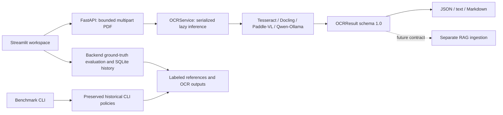

# OCR Benchmarking

A local OCR extraction service and multilingual benchmark toolkit. Compare Tesseract, Docling, PaddleOCR-VL and Qwen through a Streamlit workspace or FastAPI, with a shared versioned result format that preserves source, page and block provenance.

## Quick start

For exact verified Docker and Windows startup steps, see [Quickstart](docs/QUICKSTART.md).

Use Python 3.10 or newer; optional model packages have additional platform requirements. From the repository root:

```powershell
python -m venv .venv
.venv\Scripts\python.exe -m pip install -r requirements.txt
Copy-Item .env.example .env
.venv\Scripts\python.exe -m OCR
```

In a second terminal:

```powershell
.venv\Scripts\python.exe -m streamlit run frontend/app.py
```

On Linux/macOS use `.venv/bin/python` instead. The original `OCR/streamlit_app.py` path remains supported. Windows users can also double-click `run_app.bat`: it prefers `.venv-ocr`, checks native dependencies, starts Ollama when needed, and verifies the configured Qwen tag. Normal launcher runs can download missing Ollama assets and offer optional provider setup. `run_app.bat -CheckOnly` and `-SmokeCheck` do not provision models.

Install Tesseract 5 with `eng` (and `ara` for Arabic), and Poppler for PDF rendering. Configure executable paths only when unavailable on PATH. `OCR_POPPLER_PATH` accepts a binary directory or a Windows installation root containing `Library/bin`. Copy the environment template once; do not overwrite an existing configuration.

## Workspace

Upload a PDF, select one engine or a comparison subset, and inspect text, Markdown source, page details and provenance. Results persist across Streamlit reruns and downloads. JSON, text and available Markdown can be exported. Engines run sequentially to limit memory; CPU vision models can take minutes per page. Request durations include queueing, model loading and HTTP overhead, and are not accuracy scores.

The sidebar separates Overview, Document Processing, Benchmarking, Results & Comparison, and Settings / Provider Status. The dashboard uses actual service inventory and session activity. Optional first-page previews reuse the PDF renderer and stay in session memory. Comparison supports full-document and page-level text side by side. Repeated document/engine submissions require explicit intent; navigation and downloads do not resubmit OCR.

## System architecture



## Providers

| ID | Integration | Requirements |
| --- | --- | --- |
| `tesseract` | Lightweight CLI OCR, words/boxes/confidence | Tesseract 5 language packs and Poppler; default engine |
| `docling` | Standard document pipeline with Tesseract OCR and table/layout models | Optional packages, local Docling assets, Tesseract |
| `paddle_vl` | PaddleOCR-VL-1.6 with PP-DocLayoutV3 | Optional packages, compatible native Paddle runtime, local model directories, Poppler |
| `qwen_ollama` | Qwen2.5-VL via local Ollama | Ollama server, configured model tag, Python client (included in core requirements), Poppler |

Install `requirements-models.txt` for optional integrations. Native Paddle/Torch device setup is platform-specific; do not install CPU and GPU Paddle distributions together. `requirements-windows-cpu.txt` and its lock preserve the Windows CPU setup. Model packages/weights do not load at API startup. Providers never silently substitute another engine.

```powershell
python scripts/provision_models.py
python scripts/check_models.py --provider tesseract
```

Provisioning intentionally downloads to `models/`. Real checks write `runtime/model-check/`. Preserve model revisions for reproducible results. Qwen provisioning is managed by the Windows launcher/Ollama; select `qwen_ollama` in the API, UI or benchmark CLI. Its direct async helper remains `OCR.providers.qwen_ollama.parse_document`.

## Configuration

Repository-root `.env` is read without modifying the process environment; environment variables take precedence. Relative paths resolve from the repository root, not the current working directory. See [.env.example](.env.example) for portable defaults. Omit unused optional paths rather than setting empty values.

| Setting | Default / purpose |
| --- | --- |
| `OCR_PROVIDER` | `tesseract` |
| `OCR_API_HOST`, `OCR_API_PORT` | `127.0.0.1`, `8000` for module CLI |
| `OCR_API_URL` | `http://127.0.0.1:8000`, frontend connection |
| `OCR_UPLOAD_DIR`, `OCR_TEMP_DIR`, `OCR_OUTPUT_DIR` | Runtime upload, staging and normalized result directories |
| `OCR_MAX_UPLOAD_BYTES`, `OCR_MAX_PAGES` | 50 MiB, 100 pages |
| `OCR_RETAIN_UPLOADS` | Compatibility default `true`; template/Compose use `false` to remove request PDFs after processing |
| `OCR_PDF_DPI` | 300 for Poppler-backed adapters |
| `OCR_OPERATION_TIMEOUT` | 120 seconds for applicable native operations; not a whole-job deadline |
| `OCR_TESSERACT_LANG` | `eng`; set `ara+eng` after installing both language packs |
| `OCR_PADDLE_VL_MODEL_DIR`, `OCR_PADDLE_LAYOUT_MODEL_DIR` | Complete local Paddle model assets |
| `OCR_DOCLING_ARTIFACTS_PATH` | Complete local Docling assets |
| `OCR_PADDLE_DEVICE`, `OCR_DOCLING_DEVICE` | `cpu` |
| `OLLAMA_HOST`, `OLLAMA_OCR_MODEL` | `http://localhost:11434`, `qwen2.5vl:3b` |
| `OLLAMA_OCR_TIMEOUT`, `OLLAMA_KEEP_ALIVE` | 1800 seconds/page, 300 seconds loaded |
| `OLLAMA_NUM_CTX`, `OLLAMA_MAX_IMAGE_PIXELS` | 4096, 1000000; resolution/quality tradeoff |
| `OLLAMA_NUM_GPU` | Unset for auto; `0` forces CPU on small GPUs |

## API and normalized output

Run `python -m OCR` or `python -m uvicorn OCR.app:app --host 127.0.0.1 --port 8000 --workers 1`. Interactive API documentation: `http://127.0.0.1:8000/docs`.

```powershell
curl.exe http://127.0.0.1:8000/health
curl.exe http://127.0.0.1:8000/tools
curl.exe -X POST http://127.0.0.1:8000/extract -F "engine=tesseract" -F "file=@document.pdf;type=application/pdf"
curl.exe -X POST http://127.0.0.1:8000/extract/compare -F "file=@document.pdf;type=application/pdf"
```

`POST /extract` returns `OCRResult` schema 1.0 directly. `/extract/compare` stores the PDF once and returns `{document_id, filename, results}` with per-provider results/errors. The frontend uses sequential `/extract` calls for per-engine progress. HTTP 200 can contain recoverable document/page errors; inspect them before scoring. Unknown provider metadata stays null. Health reads known lifecycle state without inference; discovery does not guarantee installed dependencies.

Application errors: 400 invalid document/provider, 413 upload too large, 422 multipart validation, 503 unavailable provider and 500 extraction/storage failure. Application error details contain code, message and provider. See [JSON schema](docs/ocr-result.schema.json).

JSON results are retained under `runtime/`, with generated storage names. Set `OCR_RETAIN_UPLOADS=false` to remove only the current request's uploaded PDF after success or failure; comparison retains it until all providers finish. Existing documents are never swept. Source SHA-256 and original filename remain in normalized provenance even when source bytes are no longer retained. Benchmark requests instead bypass normalized-output persistence and remove their PDFs regardless of this extraction setting. Metrics-only benchmark history has a separate retention policy.

## Benchmarks and tests

Open **Benchmarking → Ground-truth evaluation**. Upload a PDF and its UTF-8 Markdown reference (maximum 2 MiB), explicitly confirm the pairing, select providers and a dataset name, choose normalization, then run. The reference is ground truth and is never sent through OCR. Review CER/WER, exact match, measured OCR duration, original texts and normalized changes. Download metrics JSON/CSV, extracted text and a detailed Markdown comparison report. Uploaded content is shown as text, never unsafe HTML.

CER = character Levenshtein substitutions + deletions + insertions, divided by normalized reference character count. WER uses whitespace-separated word tokens. Rates are unrounded in storage and may exceed 1 (100%); lower is better. Empty normalized references are rejected. Empty OCR output is scored as deletions. Exact match compares normalized strings. Character similarity is 1 − character edits / max(reference length, output length); it is a defined similarity, not an official accuracy score.

The default evaluation uses NFC Unicode normalization, whitespace and line-break normalization, and conservative removal of common Markdown syntax. Arabic letters and diacritics, punctuation and case are preserved. Choose **Raw Markdown** to score formatting, or **Plain text from Markdown** to remove common heading/list/emphasis/link/code-fence markers while retaining text. This is a conservative syntax conversion, not a rendered-document parser; inspect tables, HTML and complex nested syntax. Case folding, punctuation removal and NFKC are opt-in. Both inputs use the same settings; originals stay unchanged.

**Existing datasets** loads the repository's English/Arabic/Mix mappings. Confirm each PDF/reference association before rerunning it. Existing OCR Markdown can be rescored and saved as a new `legacy:<folder>` evaluation; original timestamps, model versions and OCR durations remain unknown. This imports newly calculated metrics, not fabricated historical measurements. Original datasets and outputs are read-only in Docker and never overwritten.

**Benchmark history** filters by provider ID, dataset name and date. Inspect records, compare selected runs, export metrics, or permanently delete a record. Compare document/reference hashes and normalization/method metadata before drawing conclusions. Dataset aggregates use micro CER/WER = total edits / total reference units and show document counts. Repeated selected runs use the newest measurement per document/reference/provider/model/package/dataset/policy; unrelated datasets are labelled separately. Historical text is intentionally unavailable after the session: export detailed reports before clearing it.

SQLite history defaults to `runtime/benchmarks.sqlite3` (`OCR_BENCHMARK_DB`) on the API's `ocr-runtime` Docker volume. Only metric/provenance metadata and hashes are persisted, with a default 90-day retention (`OCR_BENCHMARK_RETENTION_DAYS`). Expired records are pruned on history access or saving. In-progress runs are recorded before OCR; interrupted runs become failed on API restart, with no fabricated score. Benchmark source PDFs are deleted after the request; only benchmark-owned crash leftovers are removed at single-worker startup and extracted/reference text stays in the response/session only. The separate Document Processing workflow retains normalized JSON under its existing policy.

The evaluator is `levenshtein-jiwer4-v1` in `OCR/evaluation.py`. Backend endpoints: `POST /benchmarks/run`, `GET /benchmarks/history`, `POST /benchmarks/compare`, `DELETE /benchmarks/history/{id}`, `GET /benchmarks/datasets`, and `POST /benchmarks/datasets/run`. See `/docs` for multipart fields. Install `requirements-benchmark.txt` for the preserved CLI spreadsheet reports. The new backend evaluator uses explicit safe defaults; historical CLI language policies/formulas remain unchanged and must not be mixed with the new method without checking configuration.

Original PDFs, Markdown references and historical outputs/results are preserved for `English`, `Arabic` and `Mix`. Generate a fresh run only after provisioning its provider:

```powershell
python -m benchmarks.run --language English --provider tesseract --output-dir benchmarks/outputs/English/tesseract-new-run
python -m benchmarks.evaluation.evaluate_english --ocr-output benchmarks/outputs/English/tesseract-new-run
python -m benchmarks.evaluation.evaluate_arabic --ocr-output benchmarks/outputs/Arabic/tesseractocr
python -m benchmarks.evaluation.evaluate_mix --ocr-output benchmarks/outputs/Mix/markerocr
python -m pip install -r requirements-dev.txt
python -B -m pytest tests -q -p no:cacheprovider
python -m ruff check OCR frontend benchmarks/evaluation benchmarks/run.py scripts tests
```

Install development requirements before using evaluation tools. Runs require new output directories and save manifests, normalized JSON and scoring Markdown. Failed/partial documents are recorded and excluded from scoring: inspect failures to avoid misleading accuracy claims. Evaluators preserve historical language-specific normalization and unweighted per-document WER/CER, and reject overwriting reports. New evaluation reports go to `benchmarks/results/runs/`. Legacy notebooks record old environments and are not current setup instructions.

## Repository layout

```text
OCR/                    Canonical backend, schemas, providers, API and CLI
frontend/                Canonical Streamlit UI, views and HTTP transport
benchmarks/              Datasets, evaluation, historical results and runners
scripts/                 Windows launch, provisioning and real model checks
tests/                   API, provider, schema, benchmark and frontend checks
docs/                    Audit, schema and reproducibility evidence
experiments/             Preserved research notebooks
Agentic_RAG/             Future integration placeholder
```

The existing backend layout is deliberately retained to preserve imports and external integrations. `pyproject.toml` supports project metadata and installation; run repository-based benchmark/data workflows from a checkout.

## Containers and operational scope

```sh
docker compose up --build
```

Compose builds a full CPU API image by default and a lightweight UI image. The API installs Docling, PaddleOCR-VL, CPU Torch and Paddle 3.2.2; the UI avoids those heavy packages. Both include the Ollama Python client, Tesseract, Poppler and English/Arabic language packs. No weights are downloaded during build/startup. Linux native packages include OpenGL/OpenMP libraries required by the model packages. A lightweight API can be selected with `OCR_INSTALL_LOCAL_MODELS=false`; Docling/Paddle will then honestly report missing dependencies.

Existing `./models` assets mount read-only at `/models`; a writable `ocr-model-cache` volume persists library caches. Compose sets the explicit Paddle VL/layout and Docling paths. Missing or incomplete assets require operator provisioning; do not use provisioning commands unless you intend to download large weights. The model-download script supports `python scripts/provision_models.py --provider docling` or `--provider paddle_vl` after installing model dependencies locally.

Compose forwards `OLLAMA_DOCKER_HOST` (default `http://host.docker.internal:11434`) and the exact `OLLAMA_OCR_MODEL` tag to the API. The host's existing Ollama server is reused; no second server is installed. On Docker Desktop Windows verify `ollama list` and host connectivity; if needed configure Ollama's server binding as documented in [Ollama's FAQ](https://docs.ollama.com/faq), allowing only the intended local Docker access. A model pull such as `ollama pull qwen2.5vl:3b` downloads large weights and is an explicit operator step. Compose uses CPU for local Paddle/Docling. Paddle CPU initialization has a configurable 6 GiB memory-capacity safety floor (`OCR_PADDLE_MIN_MEMORY_GIB`); the observed 3.7 GiB Docker environment was OOM-killed without this guard. Use a host with enough physical RAM for a larger Docker memory budget, then verify inference; the floor does not guarantee sufficient capacity. The tested host has about 7.7 GiB of visible RAM, so allocating 8 GiB to Docker on it is not appropriate. Compose forwards `OLLAMA_NUM_GPU` (default `0` for CPU); set it deliberately for host GPU execution.

API/UI bind host loopback ports 8000/8501. Containers do not load the machine-specific root `.env`; Compose explicitly forwards supported settings. `OCR_DOCKER_API_PORT` and `OCR_DOCKER_UI_PORT` change host ports. Run `docker compose up -d --build --wait`, then visit `http://localhost:8501`.

Settings / Provider Status calls `GET /providers/diagnostics` for missing dependencies, unconfigured paths, unavailable models, unreachable Ollama, initialization failures and inference failures. Passing preflight is not Ready: run a small PDF through Document Processing (or benchmarking), then refresh status. Ready means complete actual extraction succeeded in the current API process, not that accuracy was proven. A health check confirms the web service only.

This remains a local, single-process application. Authentication, job queues, cross-process model locks and hard whole-request cancellation are not implemented. A client timeout may leave inference active; inspect history before rerunning. No deployment, commit or push is performed by this change.

Application event logs use JSON records for initialization, extraction, failures and benchmarks, excluding document filenames, extracted text and exception messages. Third-party libraries may emit their own diagnostics. GitHub Actions runs lint, basic imports/provider registration and mocked tests on Windows/Linux with Python 3.11/3.13; it needs no model downloads, GPU or Ollama server.

Current provider diagnostics and verification evidence are recorded in [ground-truth implementation report](docs/GROUND_TRUTH_REPORT.md). Earlier readiness reports describe the previous implementation.

Models, environments, secrets and new generated runs are ignored. Existing tracked upload samples and historical data remain tracked: review source permissions, dataset licenses, research documents and notebook outputs before public release. No history rewrite or publication is performed. See [repository audit](docs/REPOSITORY_AUDIT.md).

## Future RAG contract

OCR emits schema 1.0; a separate future ingestion service owns cleanup, chunking, embeddings, retrieval and generation. Preserve original artifacts, document/provider/page/block identities and exact text spans. Page offsets address document text, block offsets address page text; Unicode character offsets are half-open. Geometry declares units and origin. No RAG runtime is implemented.

## Troubleshooting

- API connection fails: start the API and check `OCR_API_URL`.
- Native executable missing: check Tesseract language packs and Poppler PATH/settings.
- Optional provider unavailable: inspect logs and complete local assets/packages; empty directories are insufficient.
- Qwen slow or GPU memory low: use CPU settings where needed and a small PDF; increasing image resolution can improve small-text recognition but increases work.
- Stale virtual environment: create an environment with an installed base interpreter; the launcher skips invalid ones.
- Benchmark mismatch: inspect export field, model revision, language configuration, failures and historical normalization before comparing scores.

### Final Paddle resource and UI verification

See [the focused final report](docs/FINAL_OCR_UI_REPORT.md) for the measured Paddle CPU memory blocker, actionable error handling, frontend improvements and verification evidence. A successful health check does not prove model inference.
